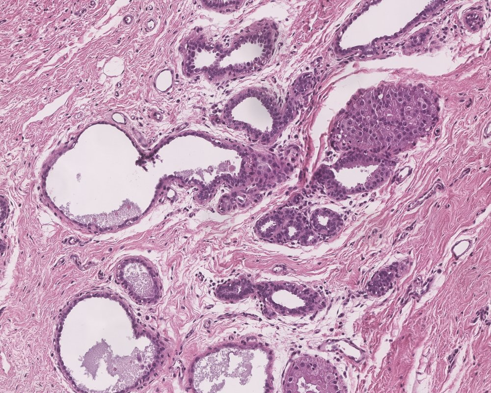
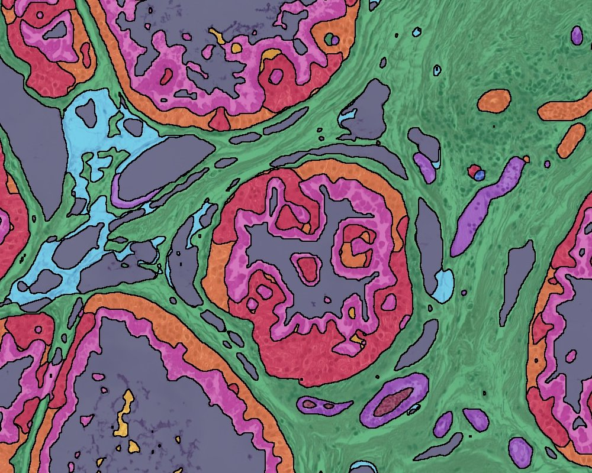
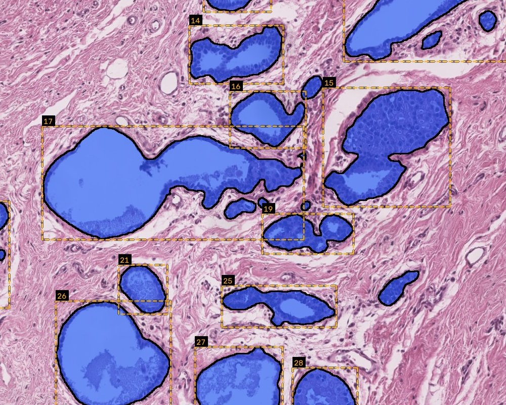

# Person C · Epithelium ROI extraction

Person C reads one raw CaseList case and finds, in every H&E whole-slide image (WSI) of the case, the **rectangles (ROIs) that
contain epithelium**. A segmentation network labels the tissue, the epithelium is cut into connected objects, and the minimum
bounding box of each object is one ROI. Person D (`visual_filter`) reopens the slide with `filepath` and `level0_info.xywh` to
rebuild the pixels; Person E (`clee`) reads the ROI geometry through H.

```text
 CaseListInput@1.0 ──▶  [ C ]  ──▶  E.ROIs@2.0  ──▶  D (visual filter)  ──▶  …
   one case              WSI → tissue classes → epithelium → boxes
```

| Item | Value |
|---|---|
| **Owner** | Person C |
| **Version** | `0.5.0`, producer string `person-c/interest-pattern:0.5.0` |
| **Input / output** | `CaseListInput@1.0` (one case per call) → `E.ROIs@2.0` |
| **Algorithm** | SEGNET student (DeepLab v3+), trained without annotation on BRACS slides |
| **Needs** | one CUDA GPU, the checkpoint under `reference/person_c/`, OpenSlide |
| **Entry point** | `python -m components.person_c.interest_pattern --input … --output … --config …` |

**Contents**
[1 Quick start](#1-quick-start) ·
[2 How it works](#2-how-it-works) ·
[3 Coordinates and ROI rules](#3-coordinates-and-roi-rules) ·
[4 Figures](#4-figures) ·
[5 Code structure](#5-code-structure) ·
[6 Environment and performance](#6-environment-and-performance) ·
[7 Limits and notes](#7-limits-and-notes) ·
[8 Changelog](#8-changelog)

---

## 1. Quick start

```bash
# one case → one E (run it inside a GPU job on a cluster, not on a login node)
python -m components.person_c.interest_pattern \
  --input  ../run/input/pipeline/case-001.json \
  --output ../run/output/work/E_rois.json \
  --config components/person_c/configs/region_proposal.json

# tests (no GPU, no slide, no checkpoint)
python -m unittest discover -s components/person_c/tests -t . -v
```

`--input` and `--output` must be below the sibling `run/`, `--config` below `components/person_c/configs/`. Two configs exist,
and the pipeline reads both by name (`pipeline/run_pipeline.py`):

| Config | `mode` | What it does |
|---|---|---|
| `configs/region_proposal.json` | `region_proposal` | The algorithm below. The pipeline's production profile. |
| `configs/example.json` | `example` | Opens no slide and makes no ROI. The pipeline's example profile and the contract tests. |

Every key of the config is described in [configs/README.md](configs/README.md). The mode names the *stage* (region proposal), not
the algorithm.

<details>
<summary><b>Container</b> (written, <b>not built</b>: there is no Docker where this was developed)</summary>

`reference/` and `run/` are mounted, not copied into the image. The pipeline starts the tag `wlw/person-c:0.1.0-lab23-production`
(overridable with `WLW_IMAGE_PERSON_C`); build with that tag or set the variable to the tag built here.

```bash
docker build -f components/person_c/Dockerfile -t wlw/person-c:0.5.0 .
docker run --rm --gpus all \
  -v "$(pwd)/../reference:/reference:ro" -v "$(pwd)/../run:/run" \
  wlw/person-c:0.5.0 \
    --input  /run/input/pipeline/case-001.json \
    --output /run/output/work/E_rois.json \
    --config /app/components/person_c/configs/region_proposal.json
```

</details>

---

## 2. How it works

```text
  WSI (H&E)
    │   tiles of 1792 µm at 1 µm/px, +112 µm of context, read by 6 worker processes
    ▼
  ┌─ student ───────────────────────────────────────────────────────────────────────────┐
  │  224 px windows, half overlap, cosine² blending                  one net   GPU      │
  │  one probability vector per 4 µm cell, 10 classes (c9)                              │
  │  enlarged bilinearly to 1 µm/px, then argmax                                        │
  └─────────────────────────────────────────────────────────────────────────────────────┘
    │  STAGE 1   tissue    class of every pixel (the student labels the glass too: class OTH)
    ▼
    │  STAGE 2   epithelium    union of TUM and BEN, every closed hole filled
    ▼
    │  STAGE 3   boxes    minimum bounding box of each connected object ≥ 6400 px,
    ▼                     a box completely inside another box dropped
  ROI records ──▶ E.ROIs
```

| Decision | What and why |
|---|---|
| **Model** | DeepLab v3+ (ResNet-101, ASPP, decoder to stride 4), 10 classes `TUM BEN STR LYM NEC FAT VES BLD SEC OTH`. Trained in PIPELINE/SEGNET (`Unsup`, spec `c9_224px_1um_sclipcrf_glvq5r2m20-bracs_wsi`, seed 0, step 6000) on unlabeled BRACS slides with the pseudo labels of the SCLIP teacher. **No annotation was used.** |
| **No foreground step** | The student labels the glass itself, so no tissue detector runs before it. |
| **1 µm/px** | The network outputs one vector per 4 µm cell. The *probabilities* (not the labels) are enlarged bilinearly before the argmax, so the borders are smooth; everything after works at 1 µm/px. |
| **Holes** | The student draws the wall of a gland. A ring that is closed is filled, and what lies inside belongs to the ring (no box of its own). A ring that is not closed cannot be filled; there a box completely inside a larger box is dropped. Boxes that only overlap are all kept. |
| **No dilation** | The mask is used as the student drew it. |
| **Checkpoint** | `reference/person_c/checkpoint/segnet/c9_sclip_bracs_s0.pt`, pinned by `revision` (SHA-256) in the config and checked before it is loaded. |
| **Provenance** | E records what produced the ROIs in `payload.reference_versions.interest_pattern`: mode, checkpoint with SHA-256, classes, `postprocess_mpp`, `min_object_size`. |

Only H&E stains are opened (the student was trained on H&E). Every other stain stays in E with `roi_num = 0` and `roi_list = []`.

---

## 3. Coordinates and ROI rules

*Downstream components rely on this section.*

| Topic | Rule |
|---|---|
| **Level 0** | The full-resolution image, origin at the upper left, x to the right, y down. `level0_info.xywh = [x, y, w, h]` in level-0 pixels covers `[x, x + w) × [y, y + h)` and always lies inside the slide. `level0_info.mpp = [mpp_x, mpp_y]` is read from the slide; a slide without MPP fails. |
| **Mask → box** | The epithelium mask is at `postprocess_mpp` (1 µm/px). Each connected object (4-connectivity) of at least `min_object_size` pixels gets its minimum bounding box, lower edge floored and upper edge ceiled after scaling to level 0, clamped to the slide. A box completely inside another box is dropped. |
| **`main_info`** | The same box in a virtual image resampled to a working MPP chosen from the box area in level-0 pixels²: up to 1, 4, 16, 64, 256, 1024 million → 0.25, 0.5, 1, 2, 4, 8 µm/px; larger → 16. `xywh` is floored / ceiled by the same scaling and clamped; `mpp` is the scalar working MPP; `area = w × h` in the pixels of that record. |
| **`cxcywh`** | `[cx / W, cy / H, w / W, h / H]` of the image of that record (contract clarification CCR-C-001). |
| **Identity** | `roi_id = <case_id>-<stain_id>-roi-<16 hex>`, a hash of case, stain and level-0 box. `global_idx` counts the ROIs of the case in stain order, `local_idx` those of the stain. The ROIs of a stain are ordered by (top, left). |
| **History** | One event per ROI: stage `interest_pattern_extraction`, owner `person_C`, action `candidate_generated`, status `selected`. `DxPair`, `visualAttrs`, `visualAttrs_info` are `null`. |
| **Crops** | `roi_path` is `null` in both records; downstream components reopen the slide with `filepath` and the box. |
| **Empty** | A stain without objects gives `roi_num = 0`; a case without any ROI is a valid E. |
| **Failure** | More than one case in the input, a missing slide, a missing MPP, a missing or wrong checkpoint, no CUDA GPU, a model error, or an E that violates the contract ends with a non-zero exit code and **no E is written**. |

---

## 4. Figures

Optional pictures of the three stages, for whoever checks the segmentation. They are drawn after the boxes are final, so they never
change the ROIs. All are off by default (`figures` in the config).

| File | Switch | Shows |
|---|---|---|
| `<name>_tissue.jpg` | `figures.tissue` | the class map, one colour per class, a black line between classes, a legend |
| `<name>_epithelium.jpg` | `figures.epithelium` | the epithelium mask the boxes come from, tinted, with a black outline |
| `<name>_boxes.jpg` | `figures.boxes` | the epithelium as above, and over it the ROI boxes (amber); optionally annotation ROIs (lime) |

`<name>` is the stem of the slide's file name (`BRACS_1003691`); the files go to `figures.dir` below `run/output`, whole or not at all.

**Example** — a 1000 × 800 µm window of BRACS_1003691 (the full figures are about 50 MB each; the upper left corner of the window is at (4 150, 4 787) of the 1 µm/px figure):

<table>
<tr>
<td valign="top"></td>
<td valign="top"></td>
<td valign="top"></td>
</tr>
<tr>
<td valign="top"><b>H&amp;E</b><br><sub>the slide, as read at 1 µm/px</sub></td>
<td valign="top"><b>tissue</b><br><sub>TUM red, BEN orange, STR green, SEC pink, FAT cyan, VES purple, OTH dark (glass, lumen)</sub></td>
<td valign="top"><b>boxes</b><br><sub>the ROIs of the method, numbered by <code>local_idx</code>, over the epithelium (TUM ∪ BEN, holes filled, black outline)</sub></td>
</tr>
</table>

**Reading the boxes figure**

- Each box of the method is an **amber** dashed rectangle. The number on the small dark label above its upper left corner is the
  `local_idx` of the ROI in E (from 0), so a box in the figure is found in the JSON. The caption gives the number of boxes.
- Lines are laid over the slide as a **translucent colour** (70 %) with a translucent dark edge of 1 px, so the slide shows through
  the line and between the dashes, and the line still stands out on light and on dark tissue. Amber lies outside the hues of H&E
  (pink, purple, blue, white).
- Optional: `figures.annotations` is a JSON `{stain_id: [[x, y, w, h], …]}` in level-0 pixels. Those ROIs are drawn in **lime**
  (long dashes, a pixel wider, numbered from 1) so that they stay apart from the amber boxes where they overlap; the caption
  gives both counts. A stain without an entry gets nothing drawn. The example above has none.

**Size.** By default a figure has the resolution of the segmentation, 1 µm/px (a 60 000 × 70 000 px slide gives about
16 000 × 18 000 px, about 50 MB). `figures.downscale` makes it that many times smaller (`4` → 4 µm/px, 16 times fewer pixels); the
segmentation and the boxes are unchanged. Colours, line width (2 px) and JPEG quality (90) are fixed.

**Looking at a full-size figure.** It is too large for most viewers and web pages. Open it with a viewer for large images
(Fiji / ImageJ, IrfanView), or cut an overview and crops where it is — inside a job, because decoding a whole figure needs several GB:

```python
import cv2
f = "BRACS_1003691_boxes.jpg"
# 1/8 of the size: 8 µm/px, about 2000 px
cv2.imwrite("overview.jpg", cv2.imread(f, cv2.IMREAD_REDUCED_COLOR_8))
# the example window above: 1000 × 800 px at 1 µm/px (rows, columns)
cv2.imwrite("crop.jpg", cv2.imread(f)[4787:5587, 4150:5150])
```

---

## 5. Code structure

Two program files, each with numbered blocks, and no sub-packages.

```text
components/person_c/
├── interest_pattern.py     what the pipeline sees              no torch: the contract tests need no GPU
│     1 Settings   the config, every key checked here
│     2 Boxes      epithelium mask → level-0 boxes
│     3 ROI        level0_info / main_info of a box, roi_id, selection history
│     4 Case       CaseList → E, one H&E stain after the other
│     5 CLI
├── segmentation.py         what the student does               torch, OpenSlide, OpenCV
│     1 Network    DeepLab v3+ (inference copy of PIPELINE/SEGNET's SegNet)
│     2 Student    checkpoint check and loading, window prediction
│     3 Slide      tiles read by worker processes, class map, epithelium mask
│     4 Figures    the JPEG of a stage
├── configs/        region_proposal.json  example.json  README.md
├── examples/       case_list.valid.json  E_rois.expected.json
├── tests/          test_person_c.py
└── README.md  PREPARATION.md  component.yaml  external-assets.yaml  requirements.txt  Dockerfile
```

```text
interest_pattern.main
  └─ run(source, config)
       ├─ validate_settings(config)                        every key checked here, nowhere else
       ├─ segmentation.load_model(settings)                checkpoint path, SHA-256, classes
       └─ per H&E stain, per WSI
            ├─ slide_mpp(slide)
            ├─ segmentation.infer_stages(path, slide, …)   → tissue, epithelium, classes [, image]
            ├─ level0_boxes(epithelium, …) → drop_enclosed(boxes)
            ├─ _make_roi(…)                                level-0 and main_info records
            └─ segmentation.save_figures(…)                only if a switch is on
```

| Step | Runs on | Note |
|---|---|---|
| Reading tiles | 6 CPU processes (`TileReader`, one slide handle each) | the slowest part; the GPU predicts the previous tile meanwhile |
| Windows, enlarging, argmax, label map, union of classes | GPU | per-pixel work |
| Hole filling, connected objects | CPU (OpenCV) | one pass over the mask, about 1 s |
| Painting of the figures | GPU, in bands of 1024 rows | blending and outline per pixel |
| JPEG encoding | CPU threads, one per figure | |

**Rules for changes**

- Every config key is validated in `validate_settings` and documented in `configs/README.md`; a new key is added to both and to a test.
- `interest_pattern.py` never imports torch at module level (`segmentation` is imported only when a slide is processed).
- The ROI geometry (section 3) is what Person D and E rely on: a change to it is a contract question, not a code cleanup.
- The network class in `segmentation.py` keeps the module names of PIPELINE/SEGNET's `SegNet`: the checkpoint is loaded with strict key checking.

---

## 6. Environment and performance

| Item | Value |
|---|---|
| Python | 3.10 in the image; the development runs used 3.12 |
| Framework | `torch 2.6.0`, `torchvision 0.21.0` (cu118 wheels) in the image; development runs: torch 2.14.0, CUDA 13.0 |
| WSI | `openslide-python 1.4.6` (any format OpenSlide reads that carries MPP; SVS was used) |
| Other | `numpy`, `opencv-python-headless`; `scipy` only in one test |
| GPU | one; peak memory 1.05 GiB measured during inference (one network, 32 windows per pass) |
| CPU | 8 (6 tile readers and the main process) |
| Checkpoint | `reference/person_c/checkpoint/segnet/c9_sclip_bracs_s0.pt`, 238 008 769 bytes, SHA-256 `b13895d5cf7ca919cb6b78e43931a5e9174f7305573964c3ed1ac5cea5b3e95b` |

External assets (the checkpoint, a test slide) are listed with digests in `external-assets.yaml`. Nothing is downloaded at build or
run time; `reference/` is read-only and everything the component writes goes below `run/`.

**Measured** on one H200 with 8 CPUs, BRACS slides (SVS, 0.2524 µm/px), `configs/region_proposal.json`:

| Slide | Run | Time | Peak host memory | ROIs |
|---|---|---|---|---|
| BRACS_1003694 | CLI, no figures | 37 s | 7.3 GB | 40 |
| BRACS_1003691 (61 879 × 70 581 px) | student, label map, holes, boxes (model loaded) | 20 s | | 152 |
| BRACS_1003691 | the same plus three figures | 32 s | | 152 |
| 9 slides of 0.7 to 2.4 GB | CLI, three figures | 32 to 69 s each | 15.7 GB (largest) | 5 to 203 |

The memory of a run with figures is mostly the slide image and the three figures at 1 µm/px.

---

## 7. Limits and notes

**Limits**

- **The ROIs are not scored.** The segmentation and the boxes were looked at in figures of a sample of BRACS slides; no ROI was compared
  with an annotation by a number. The student's own scores are in PIPELINE/SEGNET.
- **The student was trained on BRACS slides** (breast): a BRACS slide is not an independent test, and slides from other sites or
  organs may be segmented worse.
- **A box is axis-aligned.** An elongated or diagonal object gets a box that is mostly empty; overlapping boxes of neighbouring
  objects are kept; a tumour that infiltrates in single cells gives many small boxes. `coords_seg` is `null`.
- **A ring that is not closed is not filled**, so a gland whose wall has a gap keeps its lumen outside the mask.
- **Deterministic** for a given checkpoint (an argmax, no sampling); differences between GPU models were not checked.
- **Very large slides.** A figure above 2³¹ bytes of pixels is written in BGR order (an RGB→BGR copy of such an image gave black files).
  Slides above about 1 gigapixel at 1 µm/px were not tried.
- **Not run:** the container image, the full pipeline (the reference assets of Person A and E were not at hand), and Person D / E
  reading these ROIs.

**Notes for the pipeline** — nothing outside `components/person_c/` was changed.

- `mode: "region_proposal"` names the stage. The algorithm behind it is now SEGNET, not the CONCH proposal that PR #1 delivered; the
  CONCH code and checkpoint are not needed any more, and `pipeline/run_pipeline.py` needs no change.
- `reference/person_c/checkpoint/segnet/c9_sclip_bracs_s0.pt` must exist in the mounted `reference/`.
- The pipeline's image tag for C is `wlw/person-c:0.1.0-lab23-production`; this component is `0.5.0`.
- `payload.reference_versions.interest_pattern` of E has new content (it recorded the CONCH region settings before), and the ROIs
  differ from the earlier ones in number and shape (epithelium objects, not CONCH regions).
- `components/person_d/examples/person_c_integration/README.md` calls `build_region_artifact`, which is PR #1's code (commit `0ad461d`).

---

## 8. Changelog

| Version | Change |
|---|---|
| **0.5.0** | The SEGNET student replaces the CONCH region proposal (and the MRCPS segmentation before it; both stay in git history). `mode` replaces `backend`; `configs/region_proposal.json` and `configs/example.json` are the names the pipeline reads. Segmentation at 1 µm/px, per-pixel work on the GPU, tiles read by worker processes, JPEG figures of the stages with optional annotation ROIs, E records its provenance. Two program files. |
| 0.4.0 | MRCPS extractor and example mode (upstream). |
